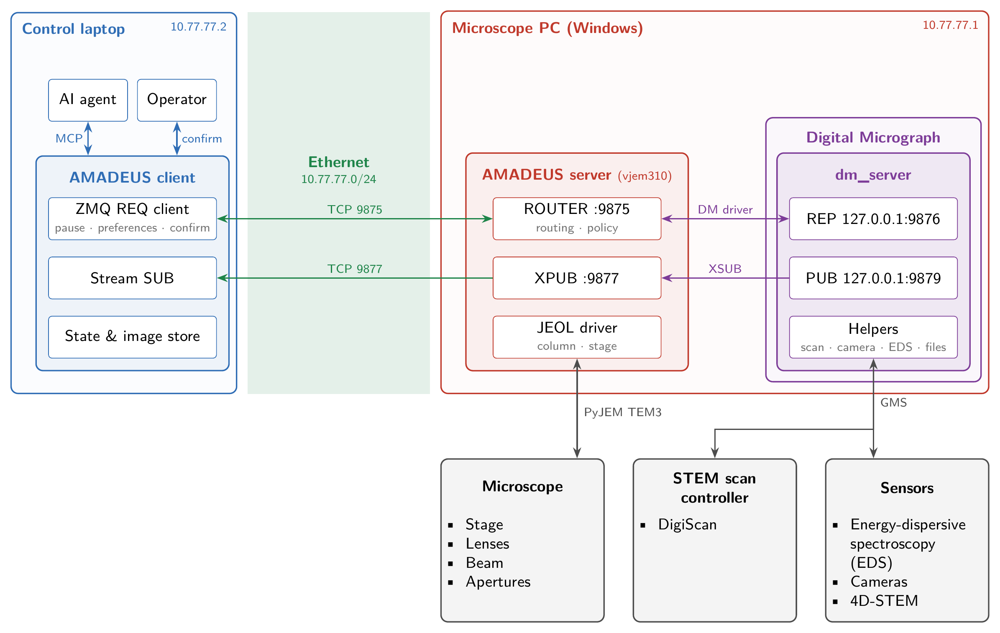

# AMADEUS

Addressable Microscope And Detector Experiment Unified Scripting (AMADEUS) is a general-purpose orchestrator for transmission electron microscopy (TEM). It unifies microscope and detector APIs from different manufacturers into a single model context protocol (MCP) interface for use with coding agents, turning the TEM into an autonomous instrument. 

AMADEUS is an ongoing project that welcomes issue reports and contributions from the community. Get in touch with George Hollyer ghollyer@seas.upenn.edu or [@george200kv](https://twitter.com/george200kv) on twitter if you would like to contribute.

## Contents

- [Why use AMADEUS?](#why-use-amadeus)
- [Requirements](#requirements)
- [Quick start](#quick-start)
- [Architecture](#architecture)
  - [Control laptop: `client/`](#control-laptop-client)
  - [Microscope PC: the AMADEUS server](#microscope-pc-the-amadeus-server)
  - [Inside Digital Micrograph: `dm_server/`](#inside-digital-micrograph-dm_server)
  - [Action blocks and sequences](#action-blocks-and-sequences)
  - [Conventions](#conventions)
- [Safety](#safety)
- [Operator interfaces](#operator-interfaces)
  - [Operator console](#operator-console)
  - [Web console](#web-console)
  - [Manual control inside Digital Micrograph](#manual-control-inside-digital-micrograph)
- [Configuration](#configuration)
  - [Entry points](#entry-points)
  - [Manual launch](#manual-launch)
  - [Reinstalling on a microscope](#reinstalling-on-a-microscope)
- [MCP tools](#mcp-tools)
- [Adding hardware](#adding-hardware)
- [Tests](#tests)
- [Disclaimers](#disclaimers)

## Why use AMADEUS?

TEM has a fragmented software ecosystem, often within a single instrument. Functions can be split across mutually unintelligible APIs operating from different environments or computers. Coding agents are difficult to install on computers running older operating systems or lacking internet access.

AMADEUS solves these issues by connecting multiple APIs into a single ZMQ network that turns MCP calls from an agent on an external computer into actions on the microscope. Commands are routed to the appropriate API and executed by a prewritten driver.

Advantages
1. **Consistent execution.** Drivers are defined by the user and can be tested beforehand.
2. **Keeps agents on an external computer.** No need to connect the microscope to the internet or give the agent direct access to the computer.
3. **Strictly defines permissions.** High consequence commands can be restricted to require manual approval. 
4. **Modularity and extensibility.** New microscopes or accessories can be added by writing new drivers.

## Requirements

- **Control laptop:** Python 3.11 or newer, and [`uv`](https://docs.astral.sh/uv/).
- **Microscope PC:** the vendor's Python environment (for JEOL, the vjem310 conda env: Python 3.10 with `pyzmq` and `tkinter`), and Digital Micrograph with Python (`numpy`, `pyzmq`).

## Quick start

All settings (IP addresses, ports, hardware mode, paths) are in one file, `amadeus_config.json`. The setup writes it on the microscope PC, and every other component reads it. The laptop fetches its copy from the PC, so the file is never copied or edited by hand.

**1. Connect the computers.** Connect the laptop to a dedicated USB-Ethernet adapter on the microscope PC, and give both ends static addresses with no gateway:

| | IPv4 | Mask | Gateway / DNS |
|---|---|---|---|
| Microscope PC (USB adapter only) | `10.77.77.1` | `255.255.255.0` | blank |
| Laptop (Ethernet adapter) | `10.77.77.2` | `255.255.255.0` | blank |

On the PC, from an Administrator prompt (`ipconfig /all` shows the adapter name; nothing else on the PC changes):

```bat
netsh interface ipv4 set address name="Ethernet 4" source=static address=10.77.77.1 mask=255.255.255.0
```

On a Mac, open System Settings → Network → the Ethernet adapter → Details → TCP/IP, choose Manually, and enter `10.77.77.2` / `255.255.255.0` with Router blank. Do not rely on self-assigned `169.254.x.x` addresses: they can change, and macOS can route traffic to them over Wi-Fi. [`docs/ETHERNET_SETUP.md`](docs/ETHERNET_SETUP.md) has the full procedure, including the safety survey and rollback.

**2. Install.** Put the same AMADEUS checkout on both computers. On the laptop:

```bash
uv pip install -e ".[dev]"
```

Nothing is installed on the microscope PC. AMADEUS runs from source in the vendor environment, which needs only `pyzmq`.

**3. Start the AMADEUS server (microscope PC).** Double-click `AMADEUS.bat`. On the first run it opens the setup:

1. Enter this PC's address (`10.77.77.1`) and the laptop's (`10.77.77.2`).
2. Confirm the detected vjem310 `python.exe`.
3. Choose *Offline* hardware mode for the first run.

The launcher then opens. Press **Start**.

**4. Start the DM server (Digital Micrograph).** Choose File › Open `scripts\start_amadeus_dm.py`, tick **Execute on Background Thread**, and press Execute. Do this once per DM session. The launcher's DM light turns green.

**5. Configure and check the laptop.**

```bash
amadeus-setup --pc 10.77.77.1    # fetch the config and register the MCP server
amadeus-check                    # ports, both drivers, read-only stage/focus/magnification
amadeus-check --image            # adds a synthetic DM image round trip (moves no hardware)
```

**6. Run.** Start your AI application (the MCP server is now registered) and `amadeus-console` to supervise it. Alternatively, run `amadeus-web` and attach the agent over HTTP (see [Web console](#web-console)).

If the laptop cannot connect, press **Network doctor** in the launcher. It checks the listeners and Windows Firewall. Only the vjem310 `python.exe` needs inbound access, on ports 9875 and 9877.

**Before the first online run** on a new instrument, run the read-only driver check in vjem310 and compare the stage readout with the microscope console:

```bash
python -m drivers.smoke --driver hw
```

Then switch the hardware mode to *Online* in the launcher's **Settings…**.

## Architecture



AMADEUS runs as three processes:

| Process | Runs on | Role |
|---|---|---|
| **AMADEUS client** (`client/`) | control laptop | Serves the MCP tools (over stdio with `amadeus-server`, or over HTTP with `amadeus-web`). Holds all state and runs all analysis. |
| **AMADEUS server** (`relay/`, `drivers/`) | microscope PC, vendor Python env | The only network endpoint on the PC. Routes each command to the driver that serves it: on the JEOL F200, the JEOL driver (PyJEM) for the column and stage, and the Digital Micrograph driver for acquisition. Republishes DM's live frames. |
| **DM server** (`dm_server/`) | inside Digital Micrograph | Cameras, STEM scanning, live streaming, spectrum imaging, EDS and data files. Listens on 127.0.0.1 only. |

The processes exchange JSON messages over ZMQ. Commands that return images send JSON metadata followed by raw NumPy bytes, which the relay forwards unchanged.

The work is split along two lines. **Orchestration** (the agent, state, analysis and the operator's interface) runs on the laptop, and **execution** runs on the microscope PC. On the PC, **hardware control** (the column, through the manufacturer's API) is kept separate from **acquisition** (cameras, scanning, spectroscopy and files, through Digital Micrograph). The microscope PC keeps no state.

Two further diagrams trace a command end to end: [a column command](docs/amadeus_flow_microscope.png) and [a camera acquisition](docs/amadeus_flow_camera.png).

### Control laptop: `client/`

- **Two front ends, one tool set.** `amadeus-server` serves the MCP tools over stdio to a desktop agent. `amadeus-web` serves the same tools over HTTP at `/mcp`, together with a browser console. Both build the server with `build_server()`, so they share tools, state and analysis. Tools are registered per domain (`client/tools/*.py`) and keep no module-level state.
- **State.** `StateManager` persists the session (saved locations, map objects, plan, preferences, task and activity) to `amadeus_state.json`. `ImageStore` saves every acquisition as `.npy` with a JSON sidecar, which records DM's calibration in DM's own units, the stage position at acquisition, and the imaging tags.
- **Analysis** (`client/analysis/`) runs on the laptop with NumPy and SciPy: FFT and CTF fitting, segmentation, particle and cluster detection, focus metrics, image registration, stage↔image Jacobian fitting, and EDS spectrum-image maps and region spectra. Pixel→stage conversion uses the measured Jacobian from the config, never a raw pixel offset.
- **A single chokepoint.** All instrument traffic passes through `ZMQClient`, one REQ socket that serialises requests. The telemetry monitor, the operator pause, the session preferences and operator confirmation all act there. The only exception is `stop_stage`, which uses a separate socket so that a stop never waits behind a move.

### Microscope PC: the AMADEUS server

- **Drivers and slots.** Each vendor's software is a *driver* that fills *slots*: `column`, `stage`, `scan`, `camera`, `live`, `spectrometer` and `files`. On the F200 the JEOL driver holds `column` and `stage`, and Digital Micrograph holds the rest. Any combination works, including several cameras or spectrometers from different vendors.
- **Routing.** One ROUTER socket receives every command and forwards it to the driver that holds its slot. In a slot with several devices, the request names a device or a role (`"detector:HAADF"`, `"camera:diffraction"`). Vendor-only commands are namespaced (`dm.list_windows`, `jeol.tem3_call`). Replies are forwarded frame by frame, so images arrive unchanged.
- **DM fallback.** Assigning the `column` and `stage` slots to the DM driver (the setup's "DM EM* scripting (fallback)" option) routes hardware control through DM's `EM*` scripting instead. This is an operator setting, deliberately not exposed as an MCP tool.
- **Policy and recovery.** The policy layer applies the config's stage limits, confirmation gates and exclusive device groups to every driver (see [Safety](#safety)). A re-sent request runs only once, and after a timeout the relay reads the affected state back into the error.
- **Driver hosting.** `drivers/base.py` defines one interface per slot. `drivers/jeol/` implements the column and stage with PyJEM TEM3, online or with JEOL's offline simulator. `drivers/sim.py` simulates every slot, including images, so the whole stack runs on a development machine without vendor software. A driver runs either inside the server on one dedicated worker thread, or in its own supervised process (`"host": "process"`) that is restarted if it crashes.
- **Stage motion.** Online PyJEM stage drives block and hold the GIL, so they run in a spawned child process (`drivers/jeol/stage_motion.py`), and the server keeps answering while the stage moves.
- **Long operations.** A request can carry its own `timeout_ms`, and the relay replies before it expires. A reply can ask the relay to keep polling (`_continue`): a waiting `move_stage` becomes a series of short `stage_poll` requests, with other commands handled in between.
- **Live stream.** The relay proxies DM's loopback PUB socket (port 9879) to the public stream port (9877), so DM never needs inbound network access.
- **Configuration and capabilities.** The relay answers `get_config` and `get_capabilities` itself. The laptop fetches its config this way, and the web console learns what the microscope supports: commands, modes, detectors, cameras and calibrations.

### Inside Digital Micrograph: `dm_server/`

The DM server is a stateless ZMQ REP server bound to 127.0.0.1: one command in, one reply out. It drives cameras, DigiScan, live-scan streaming, spectrum imaging, EDS, DM windows and `.dm3`/`.dm4` files. The live-scan session is its only state. It imports nothing from the rest of the repository, because DM executes it directly.

### Action blocks and sequences

The web console (`client/web/`, `client/blocks/`) turns every tool call into a **block** in a single FIFO queue, whether the call comes from the agent, the operator, or a step of a sequence. Blocks run one at a time. Pause, step and abort take effect between blocks; stop bypasses the queue.

**Sequences** (`*.amseq.json`) are the program format. The Blockly flow editor edits them, and they support bounded loops, if/else, variables and safe expressions. A sequence refers to detectors and cameras by **role**, not by index, and is checked against the microscope's **capabilities** before it runs, so the same sequence works on another instrument.

### Conventions

- **Device units.** Lens, deflector and stigmator values are raw DAC values (0–65535 on JEOL). The stage is sent in metres and degrees, and the high tension in volts. Focus is also reported in nanometres when the config has a measured DAC↔nm calibration (`calibrated: true`). Image calibration stays in DM's units (often µm), and any computation that needs a length converts it explicitly.
- **Wire protocol.** Requests are JSON `{"cmd", "params", "request_id"}`; replies are `{"status", "data" | "error", "request_id"}`. Image replies are multipart: JSON metadata, then raw NumPy bytes.
- **Vendor-neutral tools.** Tools use roles and names (`focus.fine`, `"objective"`, `"DIFF"`), and every device value carries its unit and range.

## Safety

Safety rules are enforced at two points that every command passes through: the policy layer on the AMADEUS server, and `ZMQClient` on the laptop.

| Rule | Where | Effect |
|---|---|---|
| `policy.stage_limits` | server | A stage target outside the limits is refused. Nothing moves, and the refusal cannot be overridden. |
| `policy.confirm` | server | Listed commands (for example valves, TEM/STEM switching, apertures) wait for the operator's approval. |
| `exclusive` device groups | server | Switching between devices in a group (for example two retractable cameras) waits for approval. |
| `policy.confirm_vendor_writes` | server | Raw vendor calls (`execute_tem3_call`, `execute_vendor_call`) that are not reads (`Get*`/`Is*`) wait for approval. On by default. |
| `max_beam_shift` | laptop | A beam shift further from neutral than this limit waits for approval. |
| Operator pause | laptop | Blocks every instrument command except `stop_stage`. |
| `--no-scripting` | laptop | Removes the scripting escape hatches (`execute_dm_script`, `execute_tem3_call`, `execute_vendor_call`) from the agent's tool set. |

**Operator confirmation.** When a command needs approval, the server replies `needs_confirmation`. The laptop then asks the operator and resends the command only if the operator chooses Allow. The agent cannot approve its own commands: `ZMQClient` drops any `confirmed` flag a tool passes. The operator is asked in the first interface available:

1. the web console (an Allow/Deny prompt in the header and the agent terminal);
2. `amadeus-console`, including `--read-only` (a dialog);
3. the agent's own host, such as Claude Code (an MCP elicitation prompt).

If none is available, or the operator does not answer in time, the command is declined. Raising `max_beam_shift` or turning off beam blanking also requires approval. [This diagram](docs/amadeus_flow_confirm.png) traces a confirmed command.

The confirmation check relies on the client: any process that talks to the relay directly is trusted. For a locked-down agent session, use the operator workspace in `operator/`, which starts the MCP server with `--no-scripting` and denies the shell, file editing and web access.

## Operator interfaces

### Operator console

`amadeus-console` is a desktop (Tk) workspace for an operator who supervises an agent session. It shows:

- the live and current images;
- quick and full manual controls;
- a map of the sample in stage coordinates;
- the session image browser;
- the current task and goals;
- agent and operator activity;
- pause and resume;
- the microscope state, refreshed periodically.

```bash
amadeus-console                   # address and data directory from amadeus_config.json
amadeus-console --read-only       # passive monitor: sends no instrument commands
amadeus-console --address tcp://<microscope-pc>:9875 --data-dir ./amadeus_data
```

The console and the MCP server must use the same data directory; both read it from the config. The Instrument tab has full manual control (status, stage, focus, beam, STEM acquisition, scan, TEM camera, spectroscopy, EDS), and the Control tab has the stage jog pad and column buttons. Operator commands use the same relay commands as the MCP tools, and are recorded with `actor: "operator"`. Images returned by operator commands are saved in the session `ImageStore`.

The MCP tools `update_session_task`, `get_session_task`, `report_agent_status` and `list_session_activity` give the agent a task and activity channel. Status entries are short summaries for the operator; the model's private reasoning is not collected.

**Read-only mode** is for watching an agent work. The console does not connect to the microscope. It reads the microscope state from the MCP server's telemetry, and it keeps **Pause / Resume** and answers confirmation requests. While paused, every instrument command is refused, and the agent's next tool call returns an error telling it to wait.

The pause works through files. The MCP server's monitor (`client/monitor.py`) writes `<data-dir>/monitor/snapshot.json`, which the console polls, and reads `<data-dir>/monitor/control.json`, which the console writes, before each command. Image pixels are read directly from the `ImageStore`. `amadeus-server --no-monitor` disables the monitor.

Use `--timeout` (seconds; default `client.timeout_s` in the config) to allow for long spectrum-imaging or EDS acquisitions. The single REQ socket serialises requests, so a long acquisition delays later commands until it returns.

### Web console

`amadeus-web` is the browser alternative to `amadeus-console`. Like `amadeus-server`, it owns the instrument connection. It listens on 127.0.0.1 only (default port 8765; set it with `--port` or `client.web_port`).

```bash
amadeus-web                       # UI at http://127.0.0.1:8765/, MCP at http://127.0.0.1:8765/mcp
```

Attach the agent to `/mcp` instead of the stdio server; `operator/` has an `amadeus-web` entry ready to enable. Each tool call the agent makes then appears as a block in the queue, alongside the operator's own blocks. The panes are:

- **Queue:** every call, oldest first, with pause, step, abort and **STOP STAGE**.
- **Blocks & scripts:** choose a tool, fill in its arguments and queue it. Run, import and export saved sequences.
- **Flow:** the Blockly sequence editor (loops, if/else, variables, operator questions). **Validate** checks a sequence against the microscope's capabilities.
- **Agent terminal:** send instructions to the agent, and answer its questions and confirmation requests.
- **Images:** stored acquisitions and the live preview, with metadata. ↑/↓ (or ←/→) step through images, and **F** shows the FFT beside the image. Calibrated images have a scale bar (nm⁻¹ on the FFT).

### Manual control inside Digital Micrograph

`dm_gui.py` runs inside Digital Micrograph and calls `dm_server.helpers` directly, without the network or the AMADEUS server. If `__file__` is not available in your DM console, set `AMADEUS_HOME` to the checkout directory first.

```python
exec(open(r"C:\path\to\AMADEUS\dm_gui.py").read())
```

## Configuration

`amadeus_config.json` holds every address, port, mode and the instrument calibration, for both computers. Each component finds it from `--amadeus-config PATH`, then the `AMADEUS_CONFIG` environment variable, then `<checkout>/amadeus_config.json`. A CLI flag overrides the config, and the config overrides the built-in defaults. `amadeus_config.example.json` lists every field; `amadeus_config.json` is git-ignored.

The instrument calibration is in the config's `instrument` section; `drivers/calibration.py` documents the format and the measuring procedure. **Settings → Load calibration file…** in the launcher imports an existing calibration file.

### Entry points

| Entry point | Runs on | Purpose |
|---|---|---|
| `AMADEUS.bat` (`amadeus-launcher`) | microscope PC | First-run setup or profile restore; then server start/stop, DM and hardware status, Readiness, Settings, Export profile, network doctor |
| `scripts/start_amadeus_dm.py` | inside DM | Starts the DM server (finds the checkout and ports itself) |
| `amadeus-setup [--pc IP]` | laptop | Fetches the config from the PC and registers the MCP server (a GUI without `--pc`) |
| `amadeus-check [--image]` | laptop | Layered connection check |
| `amadeus-server` | laptop | MCP server over stdio |
| `amadeus-console [--read-only]` | laptop | Operator console; `--read-only` is the passive monitor |
| `amadeus-web` | laptop | Browser console, action queue and HTTP MCP at `http://127.0.0.1:8765/` |
| `amadeus-driver-test` | either | Checks a driver against the slot interfaces (`--writes`, `--acquire`) |
| `python -m drivers.smoke --driver <name>` | microscope PC | Read-only first check of a configured driver, recorded for Readiness |
| `scripts/write_mcp_config.py` | laptop | Registers the MCP server again (`--claude-desktop`, `--print`) |
| `python -m setup_wizard --export/--restore` | microscope PC (vjem310) | Exports or restores the instrument profile without the GUI |

### Manual launch

Every component accepts explicit flags. Without a config file the built-in defaults apply: DM on localhost and the JEOL driver **offline**. Pass `--online` to drive a real column.

```bash
# Microscope PC, vjem310 env: the AMADEUS server
python -m relay                          # everything from amadeus_config.json
python -m relay --offline | --online | --sim [--calibration f200.json]

# Control laptop
amadeus-server                           # relay, stream and data directory from the config
amadeus-server --relay-address tcp://<microscope-pc>:9875 --data-dir ./amadeus_data --timeout-s 600
```

### Reinstalling on a microscope

Once a microscope is set up, press **Export profile…** in the launcher and store the file (for example `JEOL-F200.amadeus.json`) off the PC. The profile contains everything about the instrument and its network: addresses, ports, modes, routing, safety policy and the instrument calibration. It omits paths that differ between installations.

To reinstall:

1. Put the checkout on the PC and double-click `AMADEUS.bat`.
2. Choose **Restore from a profile…** and select the file.
3. Review the pre-filled setup and save it.
4. Press **Start**, then run the DM script.

The checkout folder and the vjem310 interpreter are detected again. A profile saved in Online mode is restored in Offline mode unless you choose otherwise, so the column cannot move before the driver smoke test has passed on the new installation. On the laptop, `amadeus-setup --pc <ip>` rebuilds everything from the PC.

**Readiness** in the launcher lists anything still missing, with the fix for each:

- the static IP address on the PC's adapter;
- the DM script, and whether DM found the checkout;
- the firewall (through the network doctor);
- in Online mode, whether the driver smoke test has passed on this installation.

Two steps cannot be automated, and Readiness names both: setting the adapter's IP address if Windows has reset it, and running the DM script in each DM session. From the command line (in vjem310):

```bash
python -m setup_wizard --export JEOL-F200.amadeus.json
python -m setup_wizard --restore JEOL-F200.amadeus.json [--keep-online]
```

## MCP tools

Vendor-specific tools are registered only when the config includes that driver: the DM window tools and `execute_dm_script` need a DM driver, and `execute_tem3_call` needs a JEOL driver. `--no-scripting` removes all three escape hatches.

| Area | Tools |
|---|---|
| Column | `get_focus`, `set_focus`, `change_focus`, `get_magnification`, `set_magnification`, `get_spot_size`, `set_spot_size`, `get_alpha`, `set_alpha`, `get_instrument_mode`, `set_instrument_mode`, `get_function_mode`, `set_function_mode`, `get_high_tension`, `get_microscope_state`, `set_beam_blank`, `set_column_valves`, `get_aperture`, `set_aperture`, `get_beam_shift`, `set_beam_shift`, `get_beam_tilt`, `set_beam_tilt`, `get_stigmation`, `set_stigmation` |
| Focus | `stem_autofocus` (focus sweep scored by image sharpness), `autofocus` (DM's routine) |
| Stage | `get_stage_position`, `move_stage_relative`, `move_stage_absolute`, `get_stage_status`, `stop_stage`, `save_stage_location`, `go_to_saved_location`, `list_saved_locations` |
| Imaging and detectors | `take_stem_image`, `take_camera_image`, `get_stem_settings`, `get_detectors`, `move_beam_to`, `get_beam_position`, `list_cameras`, `get_camera_info` |
| Live scan | `start_live_scan`, `stop_live_scan`, `get_live_status`, `get_live_frame` |
| Spectrum imaging | `configure_si`, `start_si`, `stop_si`, `get_si_status` |
| EDS | `eds_acquire_point`, `eds_acquire_map`, `eds_describe_si`, `eds_extract_elemental_map`, `eds_extract_multiple_maps`, `eds_quantify_si`, `eds_map_elements`, `eds_region_spectra`, `eds_edge_profile` |
| Image analysis | `compute_fft` (optional CTF fit), `extract_lattice_spacings`, `segment_image`, `measure_nanorods`, `find_particle_clusters`, `edge_intensity_profile`, `image_sharpness`, `measure_image_shift`, `fit_stage_image_mapping`, `convert_pixel_to_stage`, `export_image_png`, `export_overlay_png` |
| Files and images | `list_remote_files`, `fetch_remote_file`, `download_remote_file`, `list_local_images`, `inspect_image` |
| DM windows | `list_dm_windows`, `select_dm_window`, `close_dm_window`, `save_dm_window` |
| Map | `add_map_object`, `list_map_objects`, `get_map_object`, `mark_object_examined`, `link_image_to_object` |
| Plan, preferences and sample | `get_experimental_plan`, `set_experimental_plan`, `get_operational_preferences`, `set_operational_preferences`, `get_sample_metadata`, `set_sample_metadata` |
| Session | `get_session_task`, `update_session_task`, `report_agent_status`, `list_session_activity` |
| Operator channel (web console only) | `wait_for_operator`, `ask_operator`, `tell_operator` |
| Escape hatches | `execute_vendor_call`, `execute_dm_script`, `execute_tem3_call` |
| Administration | `backend_status`, `release_column_driver`, `shutdown_dm_server` |

## Adding hardware

A new manufacturer needs one driver and a `drivers` entry in the config; the relay, wire protocol, MCP tools and sequences do not change. Start from `drivers/template.py`, register the driver in `drivers/registry.py` (or through a `"class"` path or an `amadeus.drivers` entry point), and check it with `amadeus-driver-test`. [`docs/ADDING_HARDWARE.md`](docs/ADDING_HARDWARE.md) describes the slot interfaces, the rules a driver must follow, and the tests.

## Tests

```bash
uv run --with pytest --with pytest-asyncio pytest
```

The tests run offline with mocks. They need no microscope, PyJEM, Digital Micrograph or running relay.

For a full-stack check on a development machine, run `python -m relay --sim` and point `amadeus-server` or `amadeus-check` at it. Without DM, the DM driver reports as down. With a config whose `drivers` section has a single `sim` driver holding every slot, the whole stack, images included, runs without DM.

## Disclaimers

AMADEUS is not affiliated with or endorsed by Gatan Inc. or JEOL Ltd. DigitalMicrograph is a trademark of Gatan Inc. PyJEM is a product of JEOL Ltd.
